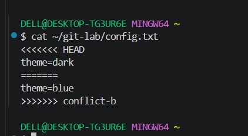
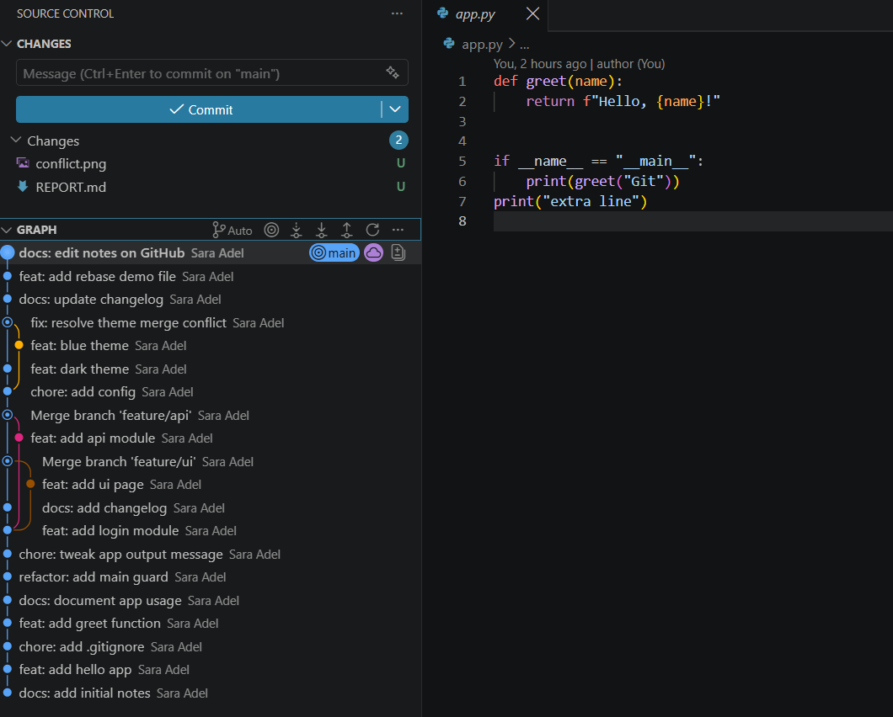
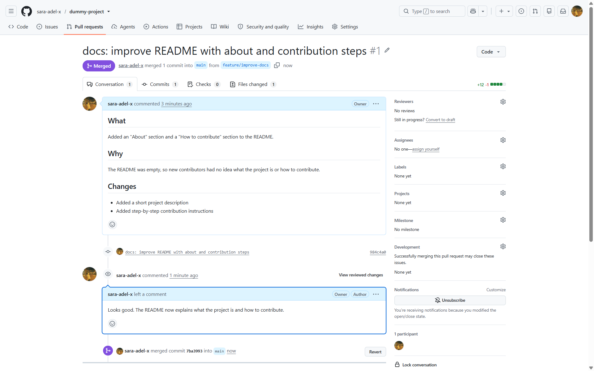

 # Git & GitHub Training Report

**Student Name:** Sara Adel
**Repository URL:** https://github.com/sara-adel-x/git-lab

---

## 📌 Part 0: Conceptual Understanding

### 1\. Git vs. SVN & Storage Models

* **Centralized (SVN) vs. Distributed (Git):**  
    
  > Centralized: there is one central server that holds the project and its whole history. Everyone works against that server, so I need a connection to it to commit or see the history. Distributed: I clone the repository and get a full copy of it, including all its history, on my own computer. I can work and commit locally without internet, and then push my changes to the remote repository later.
    
* **Deltas vs. Snapshots:**  
    
  > Delta-based systems (like SVN) store the first version of a file and then keep only the changes (deltas) made in each new version. To get a specific version, they have to apply those changes one by one. Git works differently: every time I commit, it saves a snapshot of the whole project at that moment. If a file did not change, Git does not copy it again, it just points to the same blob that already exists. This makes switching between versions and branches very fast, because Git only needs to read the snapshot.

---

## 🛠️ Task 1: "Git Lab" (Internals, Local Workflow, Undoing, Tags)

### 1\. Git Identity & Initialization

* Output of `git config --list --show-origin`:

```
$ git config --list --show-origin
file:C:/Program Files/Git/etc/gitconfig	diff.astextplain.textconv=astextplain
file:C:/Program Files/Git/etc/gitconfig	filter.lfs.clean=git-lfs clean -- %f
file:C:/Program Files/Git/etc/gitconfig	filter.lfs.smudge=git-lfs smudge -- %f
file:C:/Program Files/Git/etc/gitconfig	filter.lfs.process=git-lfs filter-process
file:C:/Program Files/Git/etc/gitconfig	filter.lfs.required=true
file:C:/Program Files/Git/etc/gitconfig	http.sslbackend=openssl
file:C:/Program Files/Git/etc/gitconfig	http.sslcainfo=C:/Program Files/Git/mingw64/etc/ssl/certs/ca-bundle.crt
file:C:/Program Files/Git/etc/gitconfig	core.autocrlf=true
file:C:/Program Files/Git/etc/gitconfig	core.fscache=true
file:C:/Program Files/Git/etc/gitconfig	core.symlinks=false
file:C:/Program Files/Git/etc/gitconfig	pull.rebase=false
file:C:/Program Files/Git/etc/gitconfig	credential.helper=manager
file:C:/Program Files/Git/etc/gitconfig	credential.https://dev.azure.com.usehttppath=true
file:C:/Program Files/Git/etc/gitconfig	init.defaultbranch=main
file:C:/Users/DELL/.gitconfig	core.editor="C:\Users\DELL\AppData\Local\Programs\Microsoft VS Code\bin\code" --wait
file:C:/Users/DELL/.gitconfig	user.email=saaraaa.adeelll@gmail.com
file:.git/config	core.repositoryformatversion=0
file:.git/config	core.filemode=false
file:.git/config	core.bare=false
file:.git/config	core.logallrefupdates=true
file:.git/config	core.symlinks=false
file:.git/config	core.ignorecase=true
file:.git/config	user.name=Sara Adel
file:.git/config	user.email=saaraaa.adeelll@gmail.com

```

### 2\. Git Architecture & Internals

* **Object Hashes:**  
    
  * Blob SHA: `620c2ef2b81285e450f8b64f824fc4c9379603f9`  
  * Tree SHA: `131b012bb75b670a54cc2bbfadc7195f16c3c996`  
  * Commit SHA: `918aa2b6f00a4066bfa57479f63bc6a6eb087c10`


* **Object Content Inspection (`git cat-file -p`):**

```
$ git cat-file -p 918aa2b6f00a4066bfa57479f63bc6a6eb087c10
tree 131b012bb75b670a54cc2bbfadc7195f16c3c996
parent 7eefca2126f919ff9dbb54d2299ccf3872ab8085
author Sara Adel <saaraaa.adeelll@gmail.com> 1791580938 +0300
committer Sara Adel <saaraaa.adeelll@gmail.com> 1791580938 +0300

refactor: add main guard

$ git cat-file -p 131b012bb75b670a54cc2bbfadc7195f16c3c996
100644 blob 282758836d053a708f7aee04c2563839e27c7683    .gitignore
100644 blob 620c2ef2b81285e450f8b64f824fc4c9379603f9    app.py
100644 blob 8e7d4a88c91e75224ebb363ef9c6d0749974e311    notes.md

$ git cat-file -p 620c2ef2b81285e450f8b64f824fc4c9379603f9
def greet(name):
    return f"Hello, {name}!"


if __name__ == "__main__":
    print(greet("Git"))
```

* **Object Type Inspection (`git cat-file -t`):**

```
$ git cat-file -t 918aa2b6f00a4066bfa57479f63bc6a6eb087c10
commit
$ git cat-file -t 131b012bb75b670a54cc2bbfadc7195f16c3c996
tree
$ git cat-file -t 620c2ef2b81285e450f8b64f824fc4c9379603f9
blob
```

* **Staging Area Verification (`git ls-files -s`):**

```
$ git ls-files -s
100644 2827... 0	.gitignore
100644 620c... 0	app.py
100644 8e7d... 0	notes.md
```
* **Brief explanation of the relationship between them:**  
    
  > Each commit points to exactly one tree. In my repo, the commit `918aa2b` points to the tree `131b012`, which is a snapshot of the project folder at that moment (which I learned from the video). The tree lists the file names (`.gitignore`, `app.py`, `notes.md`) and each name points to a blob. The blob (for example `620c2ef` for `app.py`) stores only the content of the file, not its name. The commit also has a `parent` line that links it to the previous commit, so all commits form a chain of history.

### 3\. Ignoring Files (`.gitignore`)

* Output of `git status` proving `.env` and temporary files are ignored:

```
$ git status
On branch main
nothing to commit, working tree clean

$ git status --ignored
On branch main
Ignored files:
  (use "git add -f <file>..." to include in what will be committed)
	.env
	debug.log
	temp.tmp

nothing to commit, working tree clean
```

### 4\. Inspecting Changes

* Screenshot or terminal output of `git diff` & `git diff --staged`:

```
$ git diff
warning: in the working copy of 'app.py', LF will be replaced by CRLF the next time Git touches it
diff --git a/app.py b/app.py
index 620c2ef..a86b862 100644
--- a/app.py
+++ b/app.py
@@ -4,3 +4,4 @@ def greet(name):
 
 if __name__ == "__main__":
     print(greet("Git"))
+print("extra line")

$ git add app.py
warning: in the working copy of 'app.py', LF will be replaced by CRLF the next time Git touches it

$ git diff --staged
diff --git a/app.py b/app.py
index 620c2ef..a86b862 100644
--- a/app.py
+++ b/app.py
@@ -4,3 +4,4 @@ def greet(name):
 
 if __name__ == "__main__":
     print(greet("Git"))
+print("extra line")
```

### 5\. Undoing Changes & History Recovery

* Demonstrating `git commit --amend`:

```
$ git restore --staged app.py

$ git status
On branch main
Changes not staged for commit:
  (use "git add <file>..." to update what will be committed)
  (use "git restore <file>..." to discard changes in working directory)
	modified:   app.py

no changes added to commit (use "git add" and/or "git commit -a")

$ git add app.py
warning: in the working copy of 'app.py', LF will be replaced by CRLF the next time Git touches it

$ git commit -q -m 'chore: tweak app output'

$ git show --stat HEAD
commit a3c6e3373189da8062ddb77c8e60612c0686e83d
Author: Sara Adel <saaraaa.adeelll@gmail.com>
Date:   Sat Oct 10 00:22:19 2026 +0300

    chore: tweak app output

 app.py | 1 +
 1 file changed, 1 insertion(+)

$ git commit --amend -m 'chore: tweak app output message'
[main 01f71bb] chore: tweak app output message
 Date: Sat Oct 10 00:22:19 2026 +0300
 1 file changed, 1 insertion(+)

$ git log --oneline
01f71bb chore: tweak app output message
918aa2b refactor: add main guard
7eefca2 docs: document app usage
8ee494b feat: add greet function
acbd574 chore: add .gitignore
138f4b6 feat: add hello app
6526e4b docs: add initial notes
```

* Demonstrating `git reset --hard` and recovery via `git reflog`:

```
$ git switch -c test/undo-drill
Switched to a new branch 'test/undo-drill'

$ commit 'test: commit that will be lost'
warning: in the working copy of 'app.py', LF will be replaced by CRLF the next time Git touches it
warning: in the working copy of 'drill.txt', LF will be replaced by CRLF the next time Git touches it
committed: test: commit that will be lost

$ git reset --hard HEAD~1
HEAD is now at 01f71bb chore: tweak app output message

$ git log --oneline
01f71bb chore: tweak app output message
918aa2b refactor: add main guard
7eefca2 docs: document app usage
8ee494b feat: add greet function
acbd574 chore: add .gitignore
138f4b6 feat: add hello app
6526e4b docs: add initial notes

$ git reflog
01f71bb HEAD@{0}: reset: moving to HEAD~1
eda78e1 HEAD@{1}: commit: test: commit that will be lost
01f71bb HEAD@{2}: checkout: moving from main to test/undo-drill
01f71bb HEAD@{3}: commit (amend): chore: tweak app output message
a3c6e33 HEAD@{4}: commit: chore: tweak app output
918aa2b HEAD@{5}: commit: refactor: add main guard
7eefca2 HEAD@{6}: commit: docs: document app usage
8ee494b HEAD@{7}: commit: feat: add greet function
acbd574 HEAD@{8}: commit: chore: add .gitignore
138f4b6 HEAD@{9}: commit: feat: add hello app
6526e4b HEAD@{10}: commit (initial): docs: add initial notes

$ git reset --hard eda78e128b7dd86085b8fce316304e7826f2fcbc
HEAD is now at eda78e1 test: commit that will be lost

$ git log --oneline
eda78e1 test: commit that will be lost
01f71bb chore: tweak app output message
918aa2b refactor: add main guard
7eefca2 docs: document app usage
8ee494b feat: add greet function
acbd574 chore: add .gitignore
138f4b6 feat: add hello app
6526e4b docs: add initial notes

$ git switch main
Switched to branch 'main'
```

### 6\. Tagging

* Output of `git show v1.0` (Annotated tag):

```
$ git tag v0.1

$ git tag -a v1.0 -m 'Release 1.0'

$ git tag
v0.1
v1.0

$ git show v1.0
tag v1.0
Tagger: Sara Adel <saaraaa.adeelll@gmail.com>
Date:   Sat Oct 10 00:22:20 2026 +0300

Release 1.0

commit 01f71bb8dc86dab60c1a321f7f6ab7a6d45e4bb2
Author: Sara Adel <saaraaa.adeelll@gmail.com>
Date:   Sat Oct 10 00:22:19 2026 +0300

    chore: tweak app output message

diff --git a/app.py b/app.py
index 620c2ef..a86b862 100644
--- a/app.py
+++ b/app.py
@@ -4,3 +4,4 @@ def greet(name):
 
 if __name__ == "__main__":
     print(greet("Git"))
+print("extra line")
```

---

## 🌿 Task 2: "Branch Battle" (Branching, Merging & Rebase)

### 1\. Fast-Forward Merge

* Branch merged: `feature/login` into `main`  
* Terminal output / confirmation message:

```
$ git switch -c feature/login
Switched to a new branch 'feature/login'

$ commit 'feat: add login module'
warning: in the working copy of 'login.py', LF will be replaced by CRLF the next time Git touches it
committed: feat: add login module

$ git switch main
Switched to branch 'main'

$ git merge feature/login
Updating 01f71bb..ca7e68f
Fast-forward
 login.py | 2 ++
 1 file changed, 2 insertions(+)
 create mode 100644 login.py
```

### 2\. Three-Way Merge

* Merge commit created when combining diverging branches (`feature/ui` & `feature/api`):

```
$ git switch -c feature/ui
Switched to a new branch 'feature/ui'

$ commit 'feat: add ui page'
warning: in the working copy of 'ui.html', LF will be replaced by CRLF the next time Git touches it
committed: feat: add ui page

$ git switch main
Switched to branch 'main'

$ git switch -c feature/api
Switched to a new branch 'feature/api'

$ commit 'feat: add api module'
warning: in the working copy of 'api.py', LF will be replaced by CRLF the next time Git touches it
committed: feat: add api module

$ git switch main
Switched to branch 'main'

$ commit 'docs: add changelog'
warning: in the working copy of 'CHANGELOG.md', LF will be replaced by CRLF the next time Git touches it
committed: docs: add changelog

$ git merge --no-ff --no-edit feature/ui
Merge made by the 'ort' strategy.
 ui.html | 1 +
 1 file changed, 1 insertion(+)
 create mode 100644 ui.html

$ git merge --no-ff --no-edit feature/api
Merge made by the 'ort' strategy.
 api.py | 2 ++
 1 file changed, 2 insertions(+)
 create mode 100644 api.py

```

### 3\. Merge Conflict Resolution

* Screenshot of the conflict markers (`<<<<<<<`, `=======`, `>>>>>>>`):



* Resolved commit message & terminal verification:

```
$ commit 'chore: add config'
warning: in the working copy of 'CHANGELOG.md', LF will be replaced by CRLF the next time Git touches it
warning: in the working copy of 'config.txt', LF will be replaced by CRLF the next time Git touches it
committed: chore: add config

$ git switch -c conflict-a
Switched to a new branch 'conflict-a'

$ commit 'feat: dark theme'
warning: in the working copy of 'CHANGELOG.md', LF will be replaced by CRLF the next time Git touches it
warning: in the working copy of 'config.txt', LF will be replaced by CRLF the next time Git touches it
committed: feat: dark theme

$ git switch main
Switched to branch 'main'

$ git switch -c conflict-b
Switched to a new branch 'conflict-b'

$ commit 'feat: blue theme'
warning: in the working copy of 'config.txt', LF will be replaced by CRLF the next time Git touches it
committed: feat: blue theme

$ git switch main
Switched to branch 'main'

$ git merge conflict-a
Updating be3cab6..602474f
Fast-forward
 config.txt | 2 +-
 1 file changed, 1 insertion(+), 1 deletion(-)

$ git merge conflict-b
Auto-merging config.txt
CONFLICT (content): Merge conflict in config.txt
Automatic merge failed; fix conflicts and then commit the result.

$ git status
On branch main
You have unmerged paths.
  (fix conflicts and run "git commit")
  (use "git merge --abort" to abort the merge)

Unmerged paths:
  (use "git add <file>..." to mark resolution)
	both modified:   config.txt

no changes added to commit (use "git add" and/or "git commit -a")

$ cat config.txt
<<<<<<< HEAD
theme=dark
=======
theme=blue
>>>>>>> conflict-b

$ git add config.txt
warning: in the working copy of 'config.txt', LF will be replaced by CRLF the next time Git touches it

$ git commit -m 'fix: resolve theme merge conflict'
[main 4db5c99] fix: resolve theme merge conflict

$ git log --oneline -3
4db5c99 fix: resolve theme merge conflict
602474f feat: dark theme
846afad feat: blue theme
```

### 4\. Linear History (Rebase vs. Merge)

* **Rebase Comparison:**  
    
  > A 3-way merge keeps the history of both branches and creates an extra merge commit that joins them so the graph shows branches splitting and coming back together (like my merges of feature/ui and feature/api). Rebase takes my branch commits. Replays them on top of the latest main so they get new SHAs and the history becomes one straight line with no merge commit. A linear history is easier to read. Rebase rewrites commits, so it should not be used on branches that other people already pulled. Merge is safer for branches while rebase is nicer, for cleaning up my own local feature branch before merging it.

```
$ git switch -c feature/rebase-demo
Switched to a new branch 'feature/rebase-demo'

$ commit 'feat: add rebase demo file'
warning: in the working copy of 'config.txt', LF will be replaced by CRLF the next time Git touches it
warning: in the working copy of 'rebase.md', LF will be replaced by CRLF the next time Git touches it
committed: feat: add rebase demo file

$ git switch main
Switched to branch 'main'

$ commit 'docs: update changelog'
warning: in the working copy of 'CHANGELOG.md', LF will be replaced by CRLF the next time Git touches it
committed: docs: update changelog

$ git switch feature/rebase-demo
Switched to branch 'feature/rebase-demo'

$ git log --oneline --graph --all
* 390da79 feat: add rebase demo file
| * 00a61fb docs: update changelog
|/  
*   4db5c99 fix: resolve theme merge conflict
|\  
| * 846afad feat: blue theme
* | 602474f feat: dark theme
|/  
* be3cab6 chore: add config
*   8442248 Merge branch 'feature/api'
|\  
| * 101f7ea feat: add api module
* |   6ecdbb2 Merge branch 'feature/ui'
|\ \  
| * | 7cd7aeb feat: add ui page
| |/  
* / 92f4864 docs: add changelog
|/  
* ca7e68f feat: add login module
| * eda78e1 test: commit that will be lost
|/  
* 01f71bb chore: tweak app output message
* 918aa2b refactor: add main guard
* 7eefca2 docs: document app usage
* 8ee494b feat: add greet function
* acbd574 chore: add .gitignore
* 138f4b6 feat: add hello app
* 6526e4b docs: add initial notes

$ git rebase main
Rebasing (1/1)
Successfully rebased and updated refs/heads/feature/rebase-demo.

$ git log --oneline --graph --all
* a7e1db4 feat: add rebase demo file
* 00a61fb docs: update changelog
*   4db5c99 fix: resolve theme merge conflict
|\  
| * 846afad feat: blue theme
* | 602474f feat: dark theme
|/  
* be3cab6 chore: add config
*   8442248 Merge branch 'feature/api'
|\  
| * 101f7ea feat: add api module
* |   6ecdbb2 Merge branch 'feature/ui'
|\ \  
| * | 7cd7aeb feat: add ui page
| |/  
* / 92f4864 docs: add changelog
|/  
* ca7e68f feat: add login module
| * eda78e1 test: commit that will be lost
|/  
* 01f71bb chore: tweak app output message
* 918aa2b refactor: add main guard
* 7eefca2 docs: document app usage
* 8ee494b feat: add greet function
* acbd574 chore: add .gitignore
* 138f4b6 feat: add hello app
* 6526e4b docs: add initial notes

$ git switch main
Switched to branch 'main'

$ git merge feature/rebase-demo
Updating 00a61fb..a7e1db4
Fast-forward
 rebase.md | 1 +
 1 file changed, 1 insertion(+)
 create mode 100644 rebase.md
```

### 5\. Repository Visual Graph
```
$ git branch --merged main
  conflict-a
  conflict-b
  feature/api
  feature/login
  feature/rebase-demo
  feature/ui
* main

$ git branch -d feature/login feature/ui feature/api conflict-a conflict-b feature/rebase-demo
Deleted branch feature/login (was ca7e68f).
Deleted branch feature/ui (was 7cd7aeb).
Deleted branch feature/api (was 101f7ea).
Deleted branch conflict-a (was 602474f).
Deleted branch conflict-b (was 846afad).
Deleted branch feature/rebase-demo (was a7e1db4).

$ git branch
* main
  test/undo-drill
```


* Output of `git log --oneline --graph --all`:

```
$ git log --oneline --graph --all
* a7e1db4 feat: add rebase demo file
* 00a61fb docs: update changelog
*   4db5c99 fix: resolve theme merge conflict
|\  
| * 846afad feat: blue theme
* | 602474f feat: dark theme
|/  
* be3cab6 chore: add config
*   8442248 Merge branch 'feature/api'
|\  
| * 101f7ea feat: add api module
* |   6ecdbb2 Merge branch 'feature/ui'
|\ \  
| * | 7cd7aeb feat: add ui page
| |/  
* / 92f4864 docs: add changelog
|/  
* ca7e68f feat: add login module
| * eda78e1 test: commit that will be lost
|/  
* 01f71bb chore: tweak app output message
* 918aa2b refactor: add main guard
* 7eefca2 docs: document app usage
* 8ee494b feat: add greet function
* acbd574 chore: add .gitignore
* 138f4b6 feat: add hello app
* 6526e4b docs: add initial notes
```

---

## 🌐 Task 3: "Remote & Open-Source Workflow" (Solo Simulation)

### 1\. SSH Authentication

* Verification output of `ssh -T git@github.com`:

```
$ ssh -T git@github.com
The authenticity of host 'github.com (140.82.121.3)' can't be established.
ED25519 key fingerprint is: SHA256:+DiY3wvvV6TuJJhbpZisF/zLDA0zPMSvHdkr4UvCOqU
This key is not known by any other names.
Are you sure you want to continue connecting (yes/no/[fingerprint])? yes
Warning: Permanently added 'github.com' (ED25519) to the list of known hosts.
Hi sara-adel-x! You've successfully authenticated, but GitHub does not provide shell access.
```

### 2\. Synchronization: `git fetch` vs `git pull`

* Output showing the difference after a remote commit was fetched:

```
$ git fetch
remote: Enumerating objects: 5, done.
remote: Counting objects: 100% (5/5), done.
remote: Compressing objects: 100% (3/3), done.
remote: Total 3 (delta 1), reused 0 (delta 0), pack-reused 0 (from 0)
Unpacking objects: 100% (3/3), 1019 bytes | 78.00 KiB/s, done.
From github.com:sara-adel-x/git-lab
   a7e1db4..99bffa9  main       -> origin/main

$ git status
On branch main
Your branch is behind 'origin/main' by 1 commit, and can be fast-forwarded.
  (use "git pull" to update your local branch)

Untracked files:
  (use "git add <file>..." to include in what will be committed)
        REPORT.md
        conflict.png

nothing added to commit but untracked files present (use "git add" to track)

$ git log origin/main --oneline -3
99bffa9 (origin/main, origin/HEAD) docs: edit notes on GitHub
a7e1db4 (HEAD -> main) feat: add rebase demo file
00a61fb docs: update changelog

$ git pull
Updating a7e1db4..99bffa9
Fast-forward
 notes.md | 2 ++
 1 file changed, 2 insertions(+)
```

### 3\. VS Code & GitLens Inspection

* Screenshot showing GitLens commit graph and inline blame:



### 4\. Independent Contribution & PR Simulation

* Secondary Repository URL (`dummy-project`): `https://github.com/sara-adel-x/dummy-project`  
* Remote Configuration (`git remote -v`):

```
$ git remote -v
origin  git@github.com:sara-adel-x/git-lab.git (fetch)
origin  git@github.com:sara-adel-x/git-lab.git (push)
upstream        git@github.com:sara-adel-x/dummy-project.git (fetch)
upstream        git@github.com:sara-adel-x/dummy-project.git (push)
```

* **Pull Request Link:** `https://github.com/sara-adel-x/dummy-project/pull/1`  
* Screenshot of the merged PR on GitHub:

